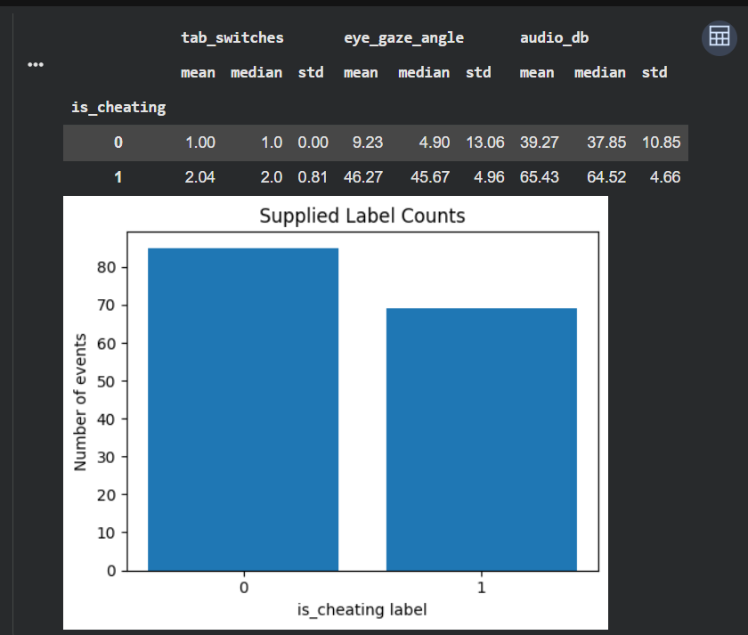
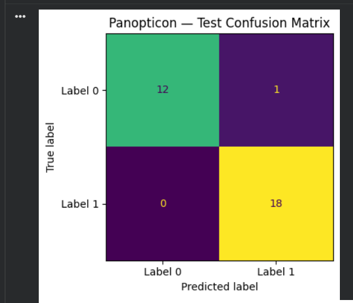
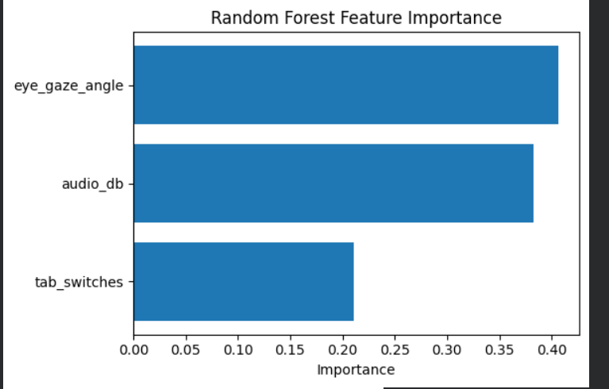
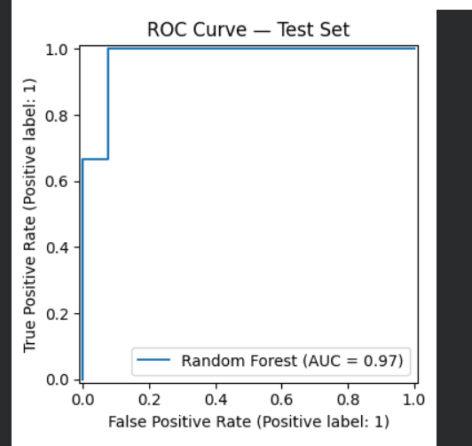
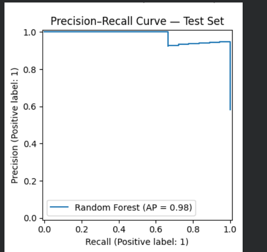

# Panopticon — Intelligent Exam Proctoring AI

An exploratory machine-learning project that analyzes exam-related telemetry and system events to predict supplied event labels.

## Overview

Panopticon explores how gaze-angle measurements, audio levels, and tab-switch counts can be combined into an event-level classification pipeline. It uses a Random Forest classifier and chronological model evaluation.

**Project status:** Research prototype. The supplied labels have not been independently verified, and the model is not validated for real-world cheating detection.

## Key Features

- Timestamp alignment of video telemetry and system events
- Missing-data inspection and preprocessing
- Event-level feature engineering
- Random Forest classification
- Chronological training, validation, and test splits
- Confusion matrix, ROC curve, precision-recall curve, and feature-importance analysis

## Tech Stack

- Python
- Pandas and NumPy
- Scikit-learn
- Matplotlib
- Google Colab / Jupyter Notebook

## Project Visualizations

### Label Distribution and Feature Summary

### Confusion Matrix

### Feature Importance

### ROC Curve

### Precision–Recall Curve

## Preliminary Evaluation

The recorded experiment used a chronological split with 91 training records, 30 validation records, and 31 test records.

| Metric | Test result |
|---|---:|
| Accuracy | 96.77% |
| Precision for label 1 | 94.74% |
| Recall for label 1 | 100.00% |
| F1-score | 97.30% |
| ROC-AUC | 0.9786 |

These are preliminary results from a small test set of 31 records. They measure prediction of the supplied labels, not verified real-world cheating. The data source and label-generation method must be documented before drawing broader conclusions.

## Running the Project

1. Install the dependencies in `requirements.txt`.
2. Open `Panopticon_Clean_Research_Notebook (1).ipynb` in Google Colab.
3. Upload the required video-telemetry and system-event CSV files when prompted.
4. Run the notebook cells in order.
5. Review the evaluation metrics and generated visualizations.

The datasets are not included in this repository. Their source and redistribution permissions must be verified separately.

## Limitations and Responsible Use

- The labelled dataset is small.
- The labels have not been independently verified.
- High test scores do not prove generalization to real examinations.
- Predictions should not be used alone to accuse or penalize a student.
- Real-world deployment would require independent validation, privacy protections, bias assessment, and human review.

## Future Improvements

- Verify dataset provenance and label definitions.
- Evaluate on additional independent datasets.
- Compare Random Forest with suitable baseline models.
- Study false-positive rates across different data conditions.
- Improve reproducibility and experiment documentation.
